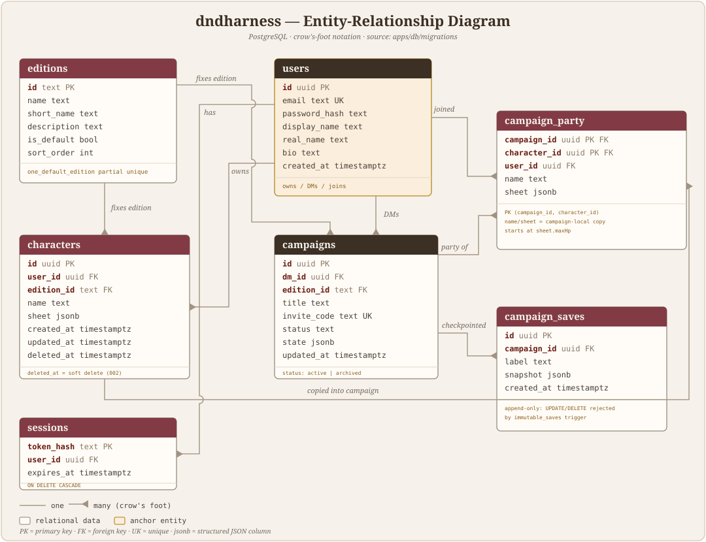

# Entity-relationship diagram

The PostgreSQL schema behind dndharness, derived from `apps/db/migrations/`.

## Relationship notes

- **`editions` is the root reference.** Every personal character and every
  campaign is fixed to one edition at creation (see `product.md`); an edition and
  a character/campaign must match when a personal character joins a campaign.
- **`users` is the anchor for people.** The same account can own characters, DM
  campaigns, and join other campaigns as a player.
- **`sessions`** holds an opaque hash of the session cookie token, keyed by user.
  No plaintext token is stored; expiry drives authentication.
- **`campaign_party` is a denormalized membership copy.** It links a campaign to
  the *original personal character* (`character_id`) while `user_id` records who
  actually joined, and `name`/`sheet` are campaign-local snapshots that evolve
  independently of the personal sheet. New copies start at maximum HP.
- **`campaign_saves` is append-only.** A trigger rejects `UPDATE`/`DELETE`, so
  snapshots are immutable checkpoints. Restore writes back to `campaigns` and
  `campaign_party`, never to saves.
- **Soft delete.** `characters.deleted_at` retains the row (personal library
  removal) while campaign copies, membership, and saved snapshots keep working.
